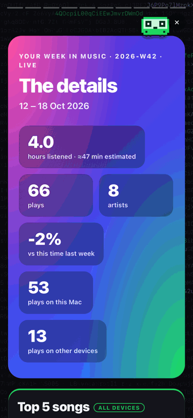
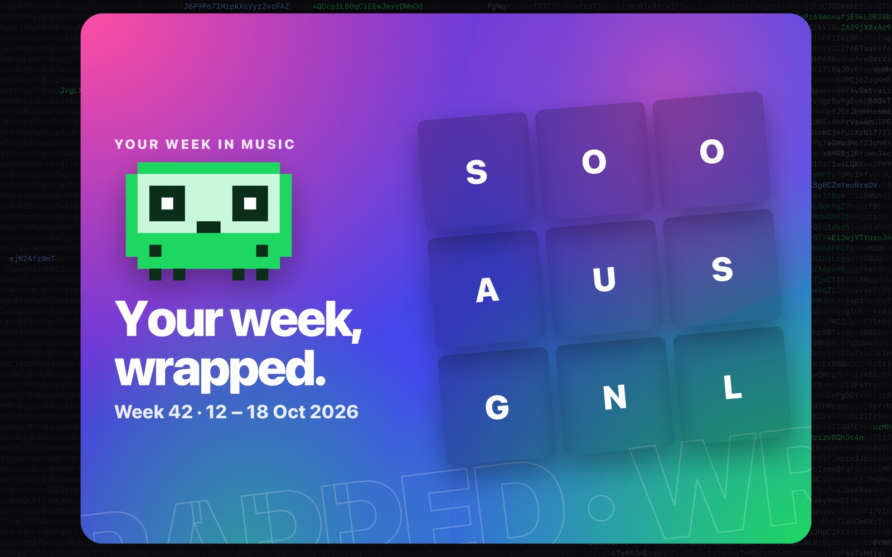
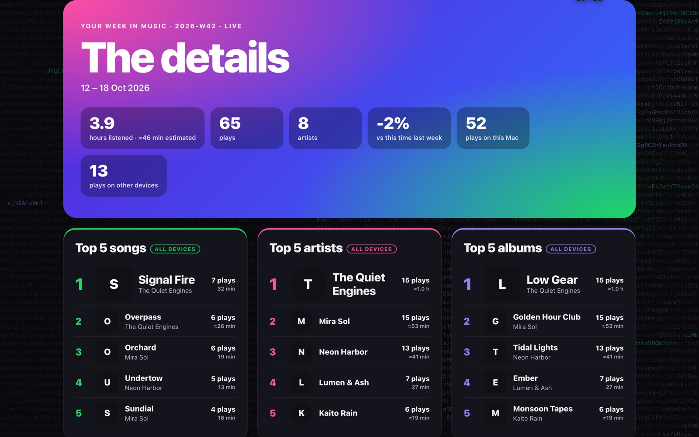
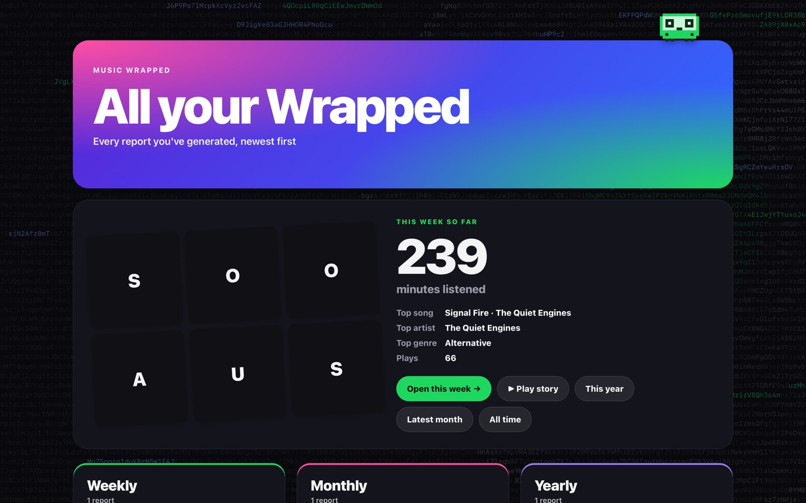
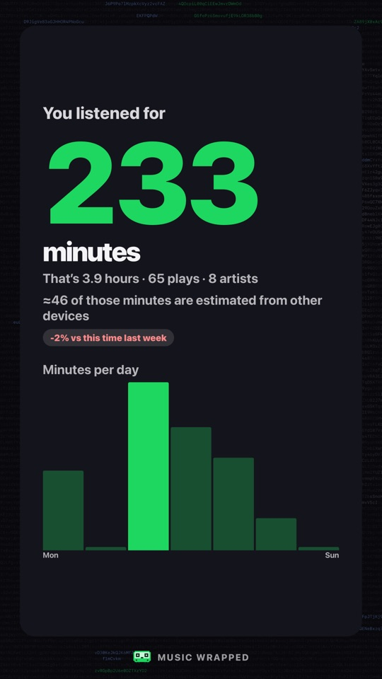
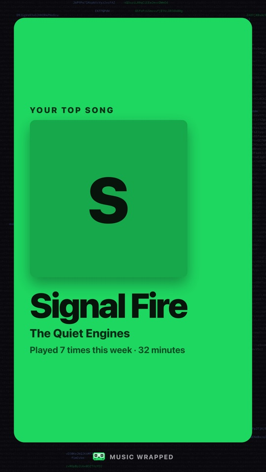
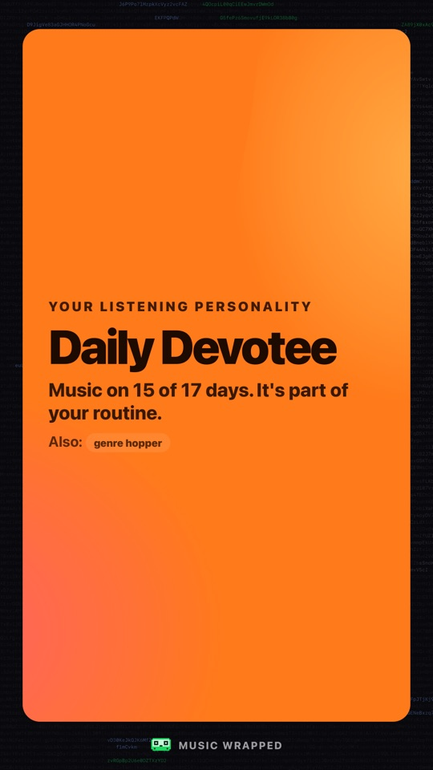

# music-wrapped

[](https://github.com/amdpaan/music-wrapped/actions/workflows/tests.yml)

A personal, Spotify-Wrapped-style recap of your **Apple Music** listening, for Apple Silicon Macs.
Everything is free and local: no paid APIs, no Apple developer account, no data leaves your Mac.

- **Logs every play on your Mac** with a tiny background helper that sleeps until the Music app
  announces a track change (`com.apple.Music.playerInfo`). No polling, nothing runs when Music is closed.
- **Also logs YT Music and other apps on your Mac** (the YT Music web app, a browser tab) from macOS's
  Now Playing, with the same counting rules. See [Other apps](#other-apps-yt-music).
- **Imports your whole library** (play counts, last played, durations) for all-time stats.
- **Picks up iPhone (and other device) plays** from synced play counts, once a day and before every report.
- **Generates Wrapped pages** (weekly, monthly, yearly, all-time and custom ranges) as single self-contained
  HTML files with your album artwork, with a clickable macOS notification when a scheduled one is ready.
- **Backs up your play history** every week: dated copies on your Mac, plus an optional private GitHub repo.
- **Writes `summary.json`** (this week's hours, top artist, top song) for desktop widgets.

<p align="center"></p>



<sub>Screenshots use the built-in demo (`music-wrapped demo`): made-up artists, and letters instead of album
covers. Your own reports show your artwork.</sub>

## Requirements

- macOS on Apple Silicon (tested on macOS 27), with the Music app
- Command Line Tools (`xcode-select --install`), which provide `swiftc` and `python3` (3.9+)
- Optional: [Homebrew](https://brew.sh). The installer uses it to add `terminal-notifier` so notifications are clickable
- For iPhone plays: **Sync Library** turned on (Music → Settings → General on the Mac, Settings → Apps → Music on the iPhone)

## Install

```sh
git clone https://github.com/<you>/music-wrapped.git
cd music-wrapped
./install.sh
```

The installer:

1. Builds the logger (`logger/main.swift`) into `$HOME/Library/Application Support/music-wrapped/bin/` and signs it
   with a local certificate (see below).
2. Installs `terminal-notifier` with Homebrew, if it's missing.
3. Adds **Music Wrapped.app** to `$HOME/Applications` and links the `music-wrapped` command into `$HOME/.local/bin`.
4. Installs six launchd agents in `$HOME/Library/LaunchAgents`:

   | Agent | When | What |
   |---|---|---|
   | `com.musicwrapped.logger` | at login, kept alive | logs Mac plays |
   | `com.musicwrapped.hourly` | every 5 minutes, only while Music is open | quick snapshot (about 0.3 s), so iPhone plays show up within minutes of syncing (never launches Music). The name is from when it ran hourly |
   | `com.musicwrapped.snapshot` | daily 12:00 | play-count snapshot (launches Music hidden if needed) + health check |
   | `com.musicwrapped.weekly` | Monday 00:05 | last week's report + all-time refresh + backup |
   | `com.musicwrapped.monthly` | 1st of the month, 09:00 | last month's report |
   | `com.musicwrapped.yearly` | 1 December, 09:05 | Jan–Nov Wrapped |

   If the Mac is asleep at a scheduled time, launchd runs the job when it wakes up.
5. Runs the **backfill** (first library snapshot).

To update later: `music-wrapped update`. It pulls the latest version and rebuilds only what changed (the
logger, which is re-signed and restarted, the story renderer, the app), re-runs the installer if that changed,
then checks that all six background jobs are running. `--rebuild` rebuilds everything anyway.

To uninstall: `./uninstall.sh` (keeps your data) or `./uninstall.sh --purge` (also deletes the data and the signing certificate).

**Signing.** macOS remembers Automation approvals per app identity. A plain (ad-hoc) build gets a new identity
every time it's rebuilt, so macOS would ask again after each update. `tools/sign-logger.sh` creates a
self-signed certificate, "music-wrapped logger (local)", in your login keychain once, and signs the logger with
it, so the approval sticks. The certificate is only used on your Mac. If signing fails, the installer
falls back to the plain signature.

## Permission prompts to expect

| Prompt | Why | Approve? |
|---|---|---|
| **"Terminal" wants access to control "Music"** | the backfill and manual reports read your library with AppleScript | Yes |
| **"sh" / "python3" / "osascript" wants access to control "Music"** (wording varies) | the same library read, when launchd runs the daily snapshot. The installer runs that job once so this prompt shows up during install | Yes |
| **"Background Items Added"** notification (one per agent, shown as "sh" or "music-wrapped-logger") | macOS tells you about new login/background items | Leave them enabled in System Settings → General → Login Items & Extensions |
| **"terminal-notifier" would like to send notifications** | shows up with the first report notification | Allow |
| **"music-wrapped-logger" wants access to control "Music"** | when the logger starts while Music is open, it asks once what's playing (see below). Poll mode uses it every 30 s. Thanks to signing, you approve it once and it's kept across updates | Yes |

Tracking itself needs no permission: the logger only listens to notifications that Music broadcasts.
The one AppleScript call at startup only catches a song that was already playing. If you deny it, everything
else still works.
Manage these later in System Settings → Privacy & Security → Automation.

## Usage

```sh
music-wrapped report weekly                # this week so far (ISO week, Mon–Sun)
music-wrapped report weekly --week 2026-W40
music-wrapped report monthly               # last month
music-wrapped report monthly --current     # this month so far
music-wrapped report monthly --month 2026-09
music-wrapped report yearly                # this year, Jan–Nov (so far, before December)
music-wrapped report alltime
music-wrapped custom 2026-09-01 2026-12-31 --name "Semester 1"

music-wrapped open                         # newest report of any kind
music-wrapped open weekly                  # reports/weekly/latest.html
music-wrapped home                         # page listing every report you've generated
music-wrapped story                        # shareable 1080x1920 story images (this week)
music-wrapped serve                        # open your reports on your iPhone over Wi-Fi (until Ctrl-C)
music-wrapped update                       # get the latest version and rebuild what changed
music-wrapped previews on                  # song previews as Play story's soundtrack (opt-in)

music-wrapped status                       # what's logged, agents loaded, latest reports, health
music-wrapped health                       # is anything broken? (exit code 1 if so)
music-wrapped snapshot                     # pick up iPhone plays now
music-wrapped backup                       # back up plays.db now (also runs every Monday)
music-wrapped backup --setup-github        # set up the private GitHub backup repo (once)
music-wrapped summary                      # rewrite + print summary.json
music-wrapped doctor                       # check that Music's notifications arrive
music-wrapped demo                         # preview every report with fake data
```

**This week's report is live.** A song on your Mac counts as soon as you've heard 30 seconds of it (its
final listening time and skip flag are filled in when it ends; still one play). The logger then rebuilds
`weekly/latest.html` and the home page in the background (no library snapshot, never starts Music), and
open tabs notice within about 5 seconds and reload, keeping your scroll position (never in the middle of
Play story). Plays from other devices arrive with the 5-minute snapshot (while Music is open) or the daily
one, as soon as iCloud has synced them to the Mac. Other reports are fixed snapshots: re-run the command to update them.

Every report command takes a library snapshot first (skip it with `--no-snapshot`) and opens the result
in your browser (skip with `--no-open`). Scheduled runs only send a notification; clicking it opens the report.

## Try it right away

You don't have to wait a week:

```sh
music-wrapped demo                     # 1. see what every report looks like (fake data, separate folder)
music-wrapped doctor                   # 2. play/pause/skip in Music during the 45 s test
# 3. listen to a few songs for 30+ s each, then:
music-wrapped status                   #    plays logged today
music-wrapped report weekly            # 4. real reports: today's plays...
music-wrapped report monthly --current
music-wrapped report yearly
music-wrapped report alltime           #    ...and your whole library from the backfill
music-wrapped custom 2026-10-01 2026-10-31 --name "Test"
```

iPhone plays show up after the **second** snapshot (the first one is only a baseline): play something on
your iPhone, wait a few minutes for iCloud to sync, then run `music-wrapped snapshot`.

## Health check

Every day, with the snapshot, music-wrapped checks that:
- all 6 jobs are loaded and the logger is running
- the logger hasn't logged errors in the last 24 h
- a snapshot has succeeded in the last 2 days (if not, the "control Music" permission was probably revoked)
- if Music has played on this Mac in the last 3 days, plays are being logged (the logger records when it last saw
  Music playing, in `heartbeat.json`)
- there's a backup from the last 8 days

It only notifies you when something is wrong. Click the notification to see the details (`health.txt`).
Run it anytime with `music-wrapped health`; `music-wrapped status` shows it too.

## Backups

`plays.db` is the only copy of your Mac play history, so it's backed up every Monday with the weekly report
(or anytime with `music-wrapped backup`):

- **On your Mac:** `backups/plays-YYYY-MM-DD.db`, the newest 8 kept. This protects against corruption or accidental deletion.
- **On GitHub (optional):** run `music-wrapped backup --setup-github` once. It creates a **private** repo
  (`<you>/music-wrapped-data`; pass a name to change it) and pushes `plays.sql`, a plain-text dump, so each
  commit only stores what changed. It never uses this public code repo, and it commits as your GitHub noreply address.

Restore from GitHub: `sqlite3 plays.db < plays.sql`. From a local copy, copy it over `plays.db`. Stop the
logger first in either case: `launchctl bootout gui/$(id -u)/com.musicwrapped.logger`, then re-run `./install.sh`.

## How a report looks

Every report opens with **Wrapped-style slides**, one big reveal per screen: an intro with a cover mosaic,
minutes listened (counting up, with a per-day chart), your top song and artist with large covers, top 5
songs, top genre, then per-report extras (when you listen, your longest streak, your biggest discovery,
top song of each month, your biggest week/month) and a summary card. Scroll (or use the dots on the right)
to move between slides; "Skip to details" jumps to **the details**: every list, chart and heatmap in calm
dark cards. Animations respect macOS's Reduce Motion setting.

Weekly and monthly reports also have a **compared with last week/month** slide: more or less listening (in %),
whether your #1 artist and song changed, your current listening streak (days in a row) and how many new
artists you found. While a week or month is still in progress it compares with the same point of the previous
one ("this time last week"), so a Tuesday isn't measured against a whole week.

**▶ Play story** (top left of every report, and on the home page) plays the slides like Instagram
stories: full screen, one at a time, 6 seconds each, with progress bars. Tap the right side for the next
slide, the left side to go back, hold to pause; ✕ or Esc returns to the page. Links ending in `#play` start
it straight away, which is handy as a Home Screen bookmark on your iPhone.

**Motion**: headlines rise in letter by letter (kinetic type), kickers tighten from wide spacing, big numbers pop in,
and giant outlined words drift across the intro and summary. Behind every slide, soft colour blobs slowly
morph shape (SVG path morphing, paused on slides you can't see), and in Play story each slide pours in like
liquid from where you tapped. Everything stays still with macOS's Reduce Motion setting and in story images.

Monthly, yearly and custom reports name your **listening personality**, from the habit that stands out most:
The Loyalist (one artist takes over a third of your plays), On Repeat, The Explorer (lots of new artists),
Night Owl, Early Bird, Weekend Warrior, Genre Hopper, Daily Devotee, or The All-Rounder when nothing
dominates. The next strongest habits are listed as extra traits.

The **yearly Wrapped** adds slides for your top 5 artists and top 5 albums, how many days you listened (and
your first song of the year), your longest streak, biggest discovery, top song of each month and your biggest month.

Every report also has **your records**: the longest listening session (back-to-back plays with breaks under
10 minutes; Mac only, since only Mac plays have exact times) and the song you replayed most in a single day.



`music-wrapped home` opens a page with **this week so far** (covers, minutes, top song/artist/genre) and
links to every report.



## Story images

`music-wrapped story` renders the same slides as 1080×1920 PNGs, plus a page showing them all,, the size of an Instagram or WhatsApp
story, and opens the folder (intro, minutes, top song, top artist, top songs, top genre, the extras for
that report, summary).

```sh
music-wrapped story                    # this week so far
music-wrapped story monthly --current  # this month so far (default: last month)
music-wrapped story yearly             # this year, Jan–Nov
music-wrapped story alltime            # from your library's play counts
```

<p>
  
  
  
</p>

They're saved in `stories/<kind>/<period>/`. Cards are drawn with the system WebKit by a small Swift tool
(`renderer/main.swift`, built by the installer or on first use) and use higher-resolution covers (640 px,
cached in `artwork/640/`).

## The Music Wrapped app

The installer adds **Music Wrapped** (with the cassette mascot as its icon) to `~/Applications`. Open it from
Launchpad, Spotlight or the Dock (drag it there to keep it) and it opens the reports home page in your browser:
this week so far, plus every report. There's no need for Terminal or a desktop widget. The app is built on your
Mac from `app/main.swift` by `tools/make-app.sh`, and re-running `./install.sh` updates it.

## Song previews in Play story (optional)

```sh
music-wrapped previews on     # off by default; "off" turns it off again
```

With previews on, ▶ Play story has a soundtrack like real Wrapped: the 30-second Apple Music preview of your top
song plays on its slide, your top artist's best song on theirs, and so on, with a 🔊/🔇 button (remembered) and
the song's name at the top. To find the previews, building a report sends each top song's **title and artist**
to Apple's public iTunes Search API (no account or key; your App Store country comes from your Mac's region).
Results are cached in `previews.json`, so rebuilds normally make no requests. Songs without a preview, or that
don't match exactly, are simply skipped; it never plays a different song.

## On your iPhone

**Story images**: run `music-wrapped story` and AirDrop the PNGs to your phone. They land in Photos.

**The full reports, over Wi-Fi**: run `music-wrapped serve` on the Mac. It shows a **QR code** in the
Terminal: point your iPhone's camera at it and tap the link. It also prints the link (like
`http://Your-Mac.local:8000/Xy3k9Q/`) and copies it to the clipboard (with Handoff, you can paste it straight
into Safari on the iPhone). The QR code is drawn by macOS itself (CoreImage, through the story renderer). You get the home page, every report and the live weekly page with all the animations.
In Safari, Share → Add to Home Screen makes it feel like an app.

- It only shares the reports folder, read-only, and only under that secret link. Folder listings, your
  database and everything else return "not found".
- It runs only while you want it to: until you press Ctrl-C, or for at most 2 hours (`--hours 0.5`, or
  `--hours 0` for no limit). Both devices need the same Wi-Fi and the Mac must be awake.
- Anyone on the same network who has the link can see your reports, so prefer your home Wi-Fi.
  `--new-link` makes a new code, and the old link stops working.
- If the macOS firewall is on, it asks once whether python3 may accept incoming connections: allow it.
- `--port 8123` if port 8000 is taken.
- Reports opened this way have a **Story images** button. It makes that report's story images on the Mac
  (about 10 seconds the first time, then cached until the report changes) and shows them on a page where
  you touch and hold each one, then **Save to Photos**. Nothing to AirDrop.

**A single report file**: you can also AirDrop a report's HTML file (for example
`reports/weekly/latest.html`; covers are built in). iOS opens it in a preview without animations,
but every slide and detail is still shown.

## Top genres

Every report has a **Top genres** card: rank, the cover of each genre's most-played song, a bar, and the
genre's share of plays (top 5; top 10 by all-time play count on the all-time page). The logger stores the
genre Music reports for each Mac play. Older plays and other-device plays use the library track's genre,
which every snapshot reads. Plays with no genre are left out of the percentages.

Different spellings of one genre count together: case, spaces and punctuation are ignored ("Hip Hop",
"hip-hop", "HipHop"), and common aliases are merged under Apple's names ("Rap" and "Hip Hop" → Hip-Hop/Rap,
"RnB" → R&B/Soul, "K Pop" → K-Pop, "Lofi" → Lo-Fi; see `GENRE_ALIASES` in `musicwrapped/stats.py`).

## Album artwork

Top songs, artists (round, using their most-played song's cover) and albums show album art, as do the yearly
top song, biggest discovery and month tiles. Artwork is exported from your Music library once per track,
shrunk to 160 px and cached in `artwork/`. After that, reports never ask Music again for that track. Each
image is embedded once per page, so reports stay single files (a full all-time page is about 0.6 MB).
Songs without artwork, or streamed but not in your library, show their first letter instead. Delete
`artwork/` to re-export everything.

## How counting works

- **Restarts**: when the logger is stopped (logout, shutdown, update), the song in progress is saved to
  `pending.json`, not logged. On start, the logger asks Music what's playing. If it's the same song (within
  10 minutes), it carries on with the same play, so one listen is never logged twice. Otherwise the saved
  song is logged and the current one is tracked from that moment.
- **Mac plays**: a play counts after **30 s** of actual listening (pauses and sleep don't count), and is
  recorded at that moment; when the song ends, the same row gets its final listening time. It's
  marked **skipped** if it stopped before 50% of the track. Each play is one row: timestamp, title, artist,
  album, duration, seconds listened, skipped and `source = 'mac'` (or `'yt'` for [other apps](#other-apps-yt-music)).
- **Other devices**: each snapshot compares every track's library play count with the previous snapshot.
  A track seen for the first time (in the backfill or any later snapshot, e.g. a song you just added on your
  iPhone) only gets a **baseline**: its existing play count is never counted as plays; only increases after
  that are. Music only increments a play count when a song plays to (about) the end, so Mac plays that reached ≥ 90% of
  the track (or ran from its start to its end with at least half heard) are subtracted, and the rest of the increase becomes `source = 'other'` rows. Their time is the
  track's "last played" date (the exact times of several plays aren't known), and listening time is
  estimated as the track length. Skips can't be known for them.
- **Real vs estimated minutes**: Mac minutes are what you actually heard (a song skipped after 1 minute adds
  1 minute). Other-device plays add the full song length, so reports mark those times with **≈** and say how
  many minutes are estimated. All-time hours are play count × song length, plus YT Music's real time.
- **iCloud backlogs**: iCloud sometimes delivers many old plays from other devices at once (e.g. +70 on one song).
  A real play always moves a song's "last played" date too, so an increase without a new last-played date is
  treated as old plays syncing in. It goes into all-time stats but isn't counted as this week's listening.
  If an increase is larger than could fit in the time since the last snapshot, at most one play is counted,
  and only if a Mac play doesn't explain the new last-played date.
  "Recent" always means at least the last hour, however often snapshots run, because iCloud can take a
  while to sync. And when a Mac song ends just before a snapshot, Music may bump its play count just after
  it: if that Mac play explains the song's new last-played date, the increase isn't counted again.
- **All-time** reports use the library play counts directly, the true total across all devices, plus the
  plays logged from [other apps](#other-apps-yt-music) such as YT Music, which the library never sees. A song
  that's in both (same title and artist) is one entry with both counts added. YT Music has no genres, so
  its plays count toward a genre only when the song is also in your library.
- **Date-range** reports (weekly, monthly, yearly, custom) add up the logged rows in that range,
  so 3 plays one week + 5 the next = 8 in that month. Nothing is counted twice.
- **Heatmap and skips are Mac only**; top lists, on-repeat, new artists and hours include all devices.
- **New artists** = no logged plays before the period, no library track by that artist added or played
  before it, and no baseline plays from before the period (plays already in the library at backfill time can't be
  dated, so they always count as "before"). So in your
  first year, the "biggest new discovery" only considers artists you start listening to after installing.

## Files

Everything personal lives outside the repo, in `$HOME/Library/Application Support/music-wrapped/`:

```
plays.db              SQLite: plays (every play, kept forever), library (all-time stats), snapshots (log)
summary.json          widget summary, rewritten after every play and report
nowplaying.json       what another app (YT Music) is playing or has paused, for widgets; removed when it stops
previews.json         cached preview links for Play story (only with `previews on`)
songinfo.json         cached song lengths, albums and genres for the YT Music history import
pending.json          song in progress while the logger restarts (usually absent)
heartbeat.json        when the logger last saw Music playing (health check)
health.txt            details of the last failed health check
config.json           {"mode": "notifications" | "poll"}
reports/index.html    home page listing every report (music-wrapped home)
reports/weekly/       2026-W42.html … latest.html
reports/monthly/      2026-10.html … latest.html
reports/yearly/       2026.html … latest.html
reports/alltime/      2026-10-17.html … latest.html
reports/custom/       2026-09-01_to_2026-12-31_semester-1.html … latest.html
logs/                 launchd job output
artwork/              cached album covers (<PID>.jpg; <PID>.none = no artwork, retried after 7 days)
stories/              story PNGs (stories/weekly/2026-W42/01-intro.png …)
backups/              weekly copies of plays.db (newest 8)
backup-repo/          clone of your private GitHub backup repo
bin/                  the compiled logger
demo/                 output of `music-wrapped demo`
```

`summary.json`:

```json
{
  "generated_at": "2026-10-17T21:04:11+08:00",
  "week": "2026-W42",
  "week_start": "2026-10-12",
  "hours": 3.6,
  "plays": 61,
  "top_artist": {"name": "…", "plays": 15},
  "top_song": {"title": "…", "artist": "…", "plays": 6}
}
```

`top_artist` / `top_song` are `null` when nothing has been played this week. Newer fields:
`top_genre {name, plays}`, a `pid` on `top_artist` and `top_song` (the cover is
`artwork/<pid>.jpg`), and `daily_minutes` (7 numbers, Monday first).

## Other apps (YT Music)

Music played on your Mac in other apps, such as YT Music (as a Safari web app or in a tab), is logged too,
from what macOS shows as Now Playing. The same rules apply: a play counts after 30 s, and it's a skip if it
stopped before 50 %. These plays have `source = 'yt'`, count as timed listening in every report and the
widget, and keep the cover macOS shows. They never touch the Music library's play counts. Plays in these
apps on your iPhone aren't included.

Since macOS 15.4, only Apple's own programs may read Now Playing, so the logger runs a small helper
(`logger/nowplaying.m`, built into `music-wrapped-nowplaying.dylib`) inside the system's `/usr/bin/perl`, the
same approach as the open-source [mediaremote-adapter](https://github.com/ungive/mediaremote-adapter). It only
reads what's playing; it never controls playback. It relies on private macOS behaviour, so a macOS update may
stop it: then only the Music app is logged, and `logs/logger.log` says so. Turn it off with
`"now_playing": false` in `config.json` and restart the logger.

### Your YT Music history (Google Takeout)

To bring in what you played on YT Music before music-wrapped logged it (on any device, iPhone included):

1. At [takeout.google.com](https://takeout.google.com), select only **YouTube and YouTube Music**, then under
   *All YouTube data included* only **history**, and under *Multiple formats* set history to **JSON**.
2. Download the zip when Google emails you (it stays in `~/Downloads`), then run:

```sh
music-wrapped import-yt              # the newest Takeout zip in ~/Downloads, or give its path
```

It reads `watch-history.json` from the zip, keeps the YT Music songs (not YouTube videos), and imports the plays
from before live logging started, as `source = 'yt-history'`. They count in the all-time Wrapped and in reports
for those past periods. Re-importing a newer export replaces the earlier import.

Takeout has no song lengths, so each song's length, album, genre and cover are looked up with Apple's public
iTunes Search API (only the title and artist are sent), with the same exact-match rule as song previews. Apple
allows about 20 lookups a minute, so a big history takes a while; it's cached in `songinfo.json` and safe to stop
and run again. Songs Apple doesn't have count as 3.5 minutes. Skip the lookups with `--no-lookup`.

Limits: YouTube lists a song as soon as it starts, so skipped songs count as plays, and the time is the song's
full length (shown as ≈ estimated). Only history that YouTube kept is there: none from while your YouTube
history was paused, or from before auto-delete removed it.

## Fallback: polling

If `music-wrapped doctor` receives no notifications, run `music-wrapped mode poll`. The logger then asks Music
for its state every 30 s via AppleScript, only while Music is running. Switch back with
`music-wrapped mode notifications`.

## Limitations

- A song that was already playing when the logger started is counted from that moment, not from its beginning.
- Plays on other devices only reach the Mac when iCloud syncs play counts, and their exact times are approximate.

## Development

```sh
python3 -m unittest discover tests     # counting rules + logger end-to-end (~30 s)
MUSIC_WRAPPED_SKIP_LOGGER_TESTS=1 python3 -m unittest discover tests   # counting rules only
swiftc -O -o build/music-wrapped-logger logger/main.swift
build/music-wrapped-logger --probe 30  # print raw Music notifications
MUSIC_WRAPPED_HOME=/tmp/mw music-wrapped demo   # use a different data folder
```

GitHub Actions runs the same tests on Apple Silicon macOS for every push (`.github/workflows/tests.yml`),
and also checks that every Swift part compiles, the demo builds every report and the renderer can draw a page.

## License

MIT. Not affiliated with Apple or Spotify.
